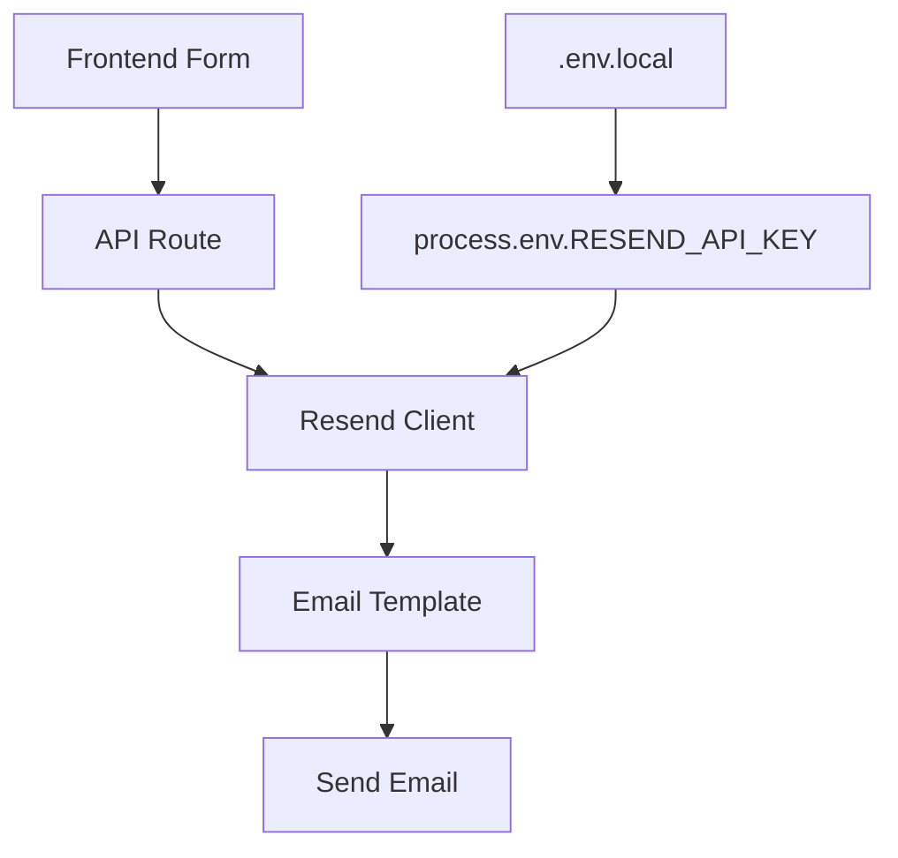

# React Email + Resend Integration - Step 3: Environment Configuration

## Overview
Step 3 completes the React Email + Resend integration by setting up proper environment configuration for development, testing, and production environments.

## Current Status
✅ **Step 1**: React Email components implemented  
✅ **Step 2**: API integration with Resend working  
🔄 **Step 3**: Environment configuration (implementing now)

## What You Need to Do

### 1. Get Your Resend API Key
1. Go to [https://resend.com/api-keys](https://resend.com/api-keys)
2. Sign in to your Resend account (or create one)
3. Create a new API key for your project
4. Copy the API key (starts with `re_`)

### 2. Create Environment Files

**Create `.env.local` file in your project root:**
```bash
# Resend API Key - Replace with your actual key
RESEND_API_KEY=re_your_actual_api_key_here

# Next.js Environment
NEXT_PUBLIC_NODE_ENV=development

# Optional: Domain for email sending
NEXT_PUBLIC_DOMAIN=localhost:3000
```

**Create `.env.example` file in your project root:**
```bash
# Copy this file to .env.local and add your actual values
RESEND_API_KEY=your_resend_api_key_here
NEXT_PUBLIC_NODE_ENV=development
NEXT_PUBLIC_DOMAIN=localhost:3000
```

### 3. TypeScript Types (✅ Already Done)
I've created `src/types/env.d.ts` with proper TypeScript declarations for your environment variables.

### 4. Test Your Setup

**Start your development server:**
```bash
bun dev
```

**Test your email API endpoints:**
```bash
# Test newsletter endpoint
curl -X POST http://localhost:3000/api/send/newsletter \
  -H "Content-Type: application/json" \
  -d '{"email": "test@example.com", "name": "Test User"}'

# Test wholesaler endpoint  
curl -X POST http://localhost:3000/api/send/wholesalers \
  -H "Content-Type: application/json" \
  -d '{"businessEmail": "test@business.com", "name": "Test Business", "companyName": "Test Co"}'
```

## Architecture Overview

### Data Flow


### Component Architecture
- **Environment Variables**: Managed via `.env.local` (development) and deployment platform (production)
- **API Routes**: `src/app/api/send/` - Handle email sending logic
- **Email Templates**: `src/components/emails/` - React Email components  
- **Type Safety**: `src/types/env.d.ts` - TypeScript environment declarations

## Production Deployment

### Environment Variables for Production

**Vercel:**
1. Go to your project dashboard
2. Settings → Environment Variables
3. Add `RESEND_API_KEY` with your production API key

**Netlify:**
1. Site Settings → Environment Variables
2. Add `RESEND_API_KEY`

**Railway/Render:**
1. Environment section in your project
2. Add `RESEND_API_KEY`

### Security Best Practices ✅
- `.env.local` is properly ignored in `.gitignore`
- API keys are never committed to source code
- TypeScript ensures environment variables are properly typed
- Separate API keys for development/production environments

## Validation Checklist

- [ ] Resend API key obtained
- [ ] `.env.local` created with actual API key
- [ ] `.env.example` created for repository
- [ ] TypeScript types working (✅ already done)
- [ ] Development server starts without errors
- [ ] Email API endpoints respond successfully
- [ ] Production environment variables configured

## Next Steps
After Step 3 is complete, your React Email + Resend integration will be fully functional for:
- Development email testing
- Production email sending
- Type-safe environment variable access
- Secure API key management

## Troubleshooting

**"RESEND_API_KEY is undefined" error:**
- Verify `.env.local` exists in project root
- Restart your development server after creating `.env.local`
- Check that the API key starts with `re_`

**Email not sending:**
- Verify your Resend account is active
- Check API key permissions
- Verify the "from" email domain is configured in Resend 